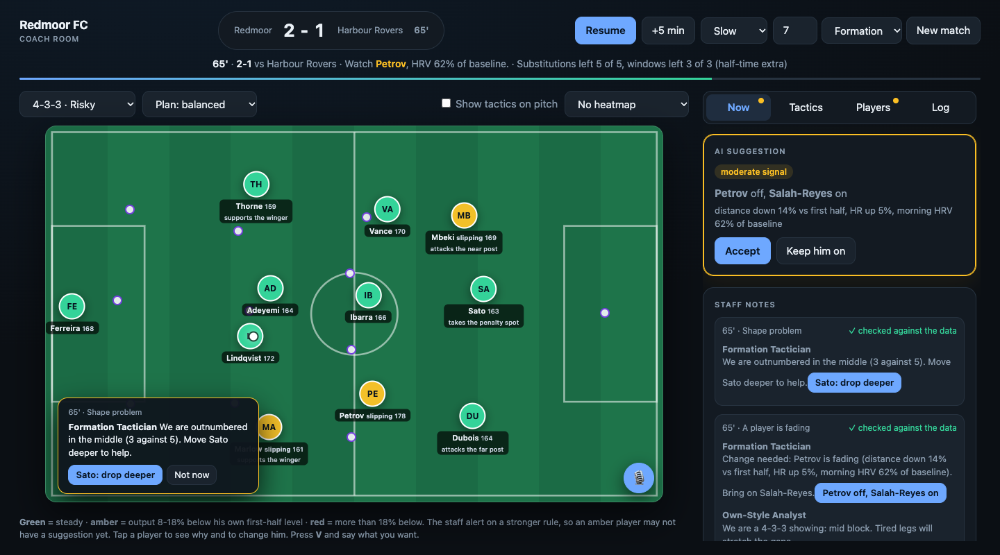

# Premier League Challenge: Redmoor FC Coach Room

Team entry for the Microsoft Inside the Game hackathon, category **Best Multi-Agent System**.

A coach-facing, multi-agent decision-support system for a fictional club (Redmoor FC). A seeded match engine streams events onto a bus; Activator-style rules fire when something changes; an orchestrator routes each trigger to the staff agents. Live on Microsoft Foundry, the analysts (Opponent, Own-Style, Formation Tactician) run in parallel, a note the rules judge flags goes back to its author once, a Coach Briefing agent merges the notes, and a Fact-checker agent screens them. The coach sees instant rule-written notes first; AI-written ones replace them only if both checks pass. A typed or dictated coach call always beats the AI, and nothing is applied automatically.

Demo video: see the project page. Architecture: [`docs/DIAGRAM.md`](docs/DIAGRAM.md).

**All data is synthetic** (fictional club, invented players, no real feeds, no logos). Real use of biometrics would need player consent.


*65' in the seed-7 scenario (synthetic data): a fading midfielder, the suggestion, the staff notes with their check mark, and a shape callout on the pitch. Nothing is applied until the coach accepts or dictates his own change.*

## What runs, and what does not
| Runs offline (no keys) | Runs live on Microsoft Foundry (verified Oct 22 and Oct 27) | Designed, not run live |
|---|---|---|
| Match engine: formations, role chains, instruction sliders, per-player orders, wellness and HRV readiness | Staff pipeline with in-process Agent Framework agents: parallel analysts, critic and revise, Coach Briefing, Fact-checker | Microsoft-Decision-1 (not deployed; heuristic fallback runs) |
| Event bus, Activator rules, orchestrator, rules judge with citations, benchmark, replay comparison | The same five agents hosted in Foundry Agent Service, called by reference | Azure Event Hubs, Fabric Eventstream/Eventhouse/Activator |
| Coach interface: one-tap actions, voice or typed override, formation overlay, trace of every step | Foundry Groundedness evaluator: 19 live notes, 4.16 of 5 as written vs 2.00 with one number changed | Azure Container Apps (Dockerfile built and run locally only) |
| 97 tests, CI on every push | LLM rubric judge; fan and analyst recap workflow (Analyst, Explainer, Personalizer) | |

Offline benchmark metrics are tautological (notes are generated from the facts); they show the checks work, not that the advice is good. The live evaluation is small. See `docs/ARCHITECTURE.md`.

## Run
```
uv sync
uv run uvicorn plc.api:app --port 8765     # coach room at http://localhost:8765
uv run pytest -q                           # 97 tests, offline
uv run python -m plc bench                 # briefing quality: grounded rate, judge catch rate, citation coverage
uv run python -m plc replay [seeds]        # no changes vs AI accepted vs scripted coach
uv run python -m plc demo                  # terminal demo
uv run python -m plc dataset [seed]        # regenerate data/bronze (about 5 MB)
```
Live on Foundry (needs a Foundry project, the variables in `.env.example`, and `az login`):
```
cp .env.example .env                                   # fill FOUNDRY_PROJECT_ENDPOINT and FOUNDRY_MODEL
az login
uv run uvicorn plc.api:app --port 8765                 # the UI fetches AI-written notes in the background
uv run --extra foundry python -m plc publish           # publish the five staff agents to Foundry Agent Service
FOUNDRY_HOSTED_AGENTS=1 uv run --extra foundry uvicorn plc.api:app --port 8765   # use the hosted agents
uv run --extra eval python -m plc evaluate             # Foundry Groundedness on live notes, clean vs corrupted
uv run python -m plc fan                               # fan recap workflow (or: analyst)
```
Without those variables everything runs offline on rules and a heuristic.

## Docs
- `docs/SUBMISSION.md` submission text. `docs/PITCH.md` longer pitch and honest limits. `docs/DEMO_SCRIPT.md` video script (`scripts/record_demo.js` records it). `docs/DIAGRAM.md` architecture diagram.
- `docs/ARCHITECTURE.md` event flow, medallion layers, Fabric and Foundry mapping, benchmarking. `docs/RESEARCH.md` prior art and tactics research.
- `docs/DEPLOY.md` container and Azure Container Apps. `docs/PLAN_LEAD.md`, `docs/PLAN_EXPERIMENTS.md`, `docs/EXPERIMENTS.md` the two tracks.
- `CLAUDE.md` project rules (synthetic data only, noreply commit email, coach always decides).
