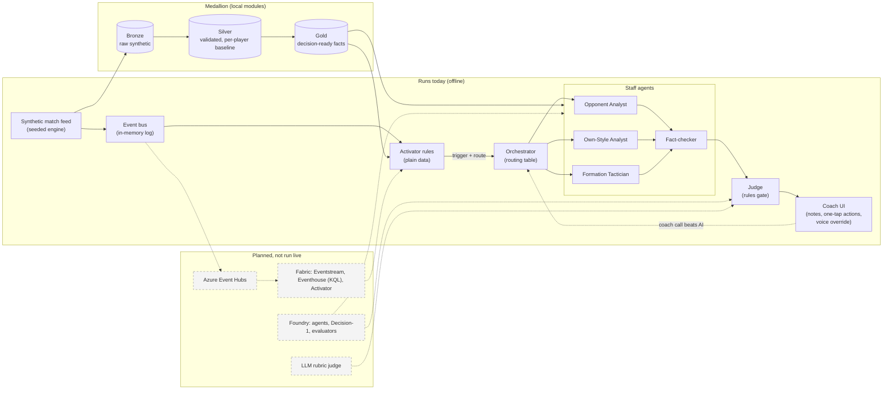

# Architecture diagram

Solid boxes run today (offline, locally). Dashed boxes are planned: designed but not run live.

## Legend
- Solid arrow: data or control flow that runs today.
- Dashed arrow and dashed box: planned, designed but not run live.
- Bronze, silver, gold: data moves one way, each layer reads only the one before. Agents read gold only (the Fact-checker may also query silver and cite it). Agents never write to bronze or silver.
- "Coach call beats AI": a typed or dictated override replaces any suggestion; nothing is auto-applied.
- Today the medallion layers map to local modules; the Fabric Eventhouse version is planned.
