# Architecture diagram

Solid boxes run today. Blue boxes run live on Microsoft Foundry (verified Oct 22 and Oct 27). Dashed boxes are designed but not run live.

```mermaid
flowchart LR
  feed["Synthetic match feed<br/>(seeded engine)"] --> bus["Event bus<br/>(in-memory log)"]
  bus --> act["Activator rules<br/>(plain data, fire on change)"]
  act -->|trigger + route| orch["Orchestrator<br/>(routing table)"]
  orch -->|instant| rules["Rule-written notes<br/>+ one-tap actions"]
  orch -->|live, about 45 s| staff

  subgraph staff["Live staff pipeline (Foundry, Agent Framework)"]
    direction TB
    subgraph fan["1. Analysts in parallel"]
      opp["Opponent Analyst"]:::live
      own["Own-Style Analyst"]:::live
      tac["Formation Tactician"]:::live
    end
    crit["2. Critic and revise<br/>rules judge flags a note,<br/>its author rewrites once"]:::live
    coach["3. Coach Briefing<br/>merges into one call"]:::live
    fc["4. Fact-checker agent"]:::live
    fan --> crit --> coach --> fc
  end

  rules --> ui["Coach UI<br/>(notes, buttons, voice override,<br/>trace of every step)"]
  fc --> gate{"Rules judge ✓<br/>and Fact-checker ✓?"}
  gate -->|yes: swap in AI-written notes| ui
  gate -->|no: keep rule-written notes| ui
  ui -. "coach call beats AI" .-> orch

  subgraph medal["Medallion (local modules)"]
    bronze[("Bronze<br/>raw synthetic")] --> silver[("Silver<br/>per-player baseline")] --> gold[("Gold<br/>decision-ready facts")]
  end
  feed --> bronze
  gold --> act
  gold --> staff

  host["Foundry Agent Service:<br/>the same 5 agents hosted,<br/>called by reference"]:::live -.->|FOUNDRY_HOSTED_AGENTS=1| staff
  eval["Foundry Groundedness evaluator<br/>(python -m plc evaluate)"]:::live -.-> staff

  subgraph planned["Designed, not run live"]
    eh["Azure Event Hubs"]:::plan
    fab["Fabric: Eventstream, Eventhouse (KQL), Activator"]:::plan
    dec["Microsoft-Decision-1"]:::plan
  end
  bus -.-> eh -.-> fab -.-> act
  dec -.-> rules

  classDef live fill:#dbeafe,stroke:#2563eb,color:#111
  classDef plan stroke-dasharray: 5 5,fill:#f4f4f4,stroke:#888,color:#333
```

## Legend
- **Two speeds.** The coach gets rule-written notes and buttons instantly. The live pipeline runs in the background and replaces them only if both checks pass.
- **Four live steps.** Analysts fan out in parallel. A note the rules judge flags goes back to its author once with the exact problems. The Coach Briefing agent merges the notes into one call. The Fact-checker agent screens everything.
- **Agents explain, rules act.** Buttons come from rules, never from model text, so a model cannot invent an action.
- **One pipeline, two backends.** The same pipeline (`staff.staff_flow`) runs with in-process Agent Framework agents or with the agents hosted in Foundry Agent Service.
- **Data flow.** Data moves one way: bronze, then silver, then gold. Agents read gold only.
- **Coach call beats AI.** A typed or dictated override replaces any suggestion, and nothing is auto-applied.
